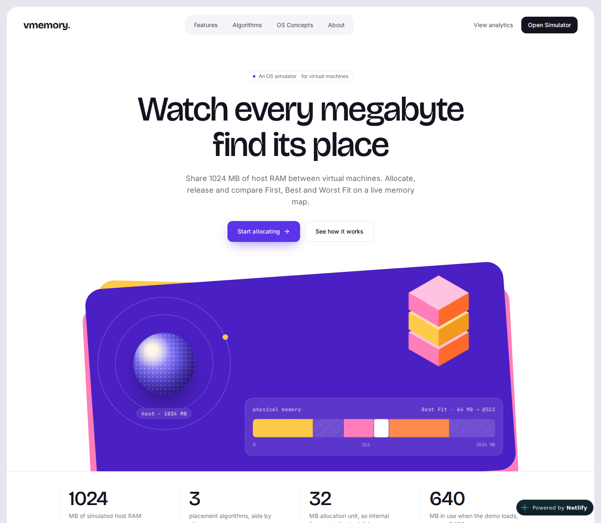
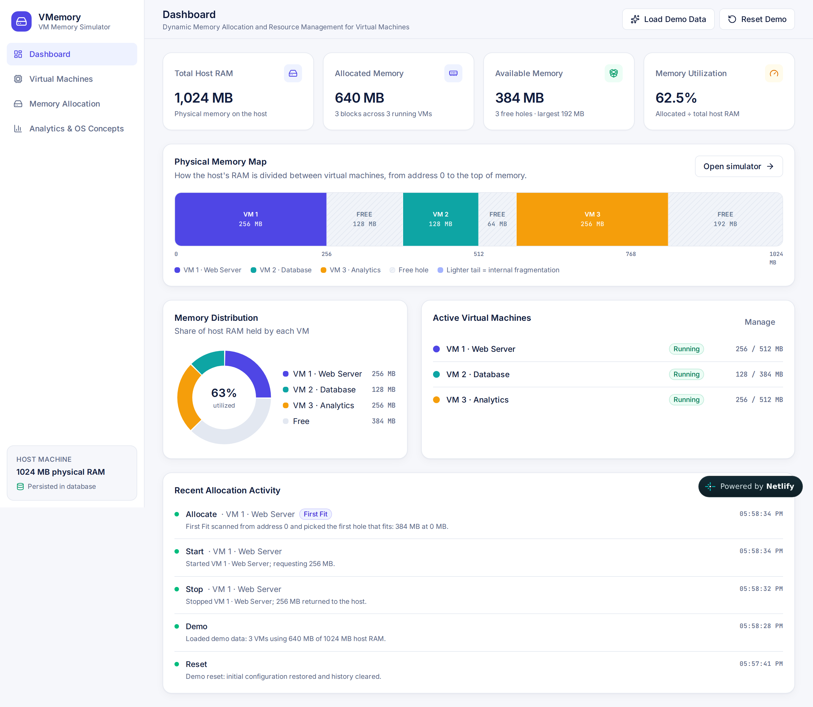

# VMemory — Dynamic Memory Allocation and Resource Management for Virtual Machines

**Live demo:** [https://vmemory.netlify.app](https://vmemory.netlify.app)





An educational Operating Systems simulator showing how a host computer shares its limited physical RAM (1024 MB) between virtual machines. You can create VMs, allocate and release memory with **First Fit**, **Best Fit** and **Worst Fit**, and watch the physical memory map, utilization and fragmentation update. It does not control a real hypervisor.

## Sections
1. **Dashboard**: host RAM statistics, a segmented physical memory map, a distribution chart, active VMs and recent activity.
2. **Virtual Machines**: add VMs (name, initial memory, maximum memory, priority), start/stop, delete.
3. **Memory Allocation**: the simulator. Pick a VM, a request size and an algorithm, then allocate. Click a block to release it. A live hole table shows which hole each algorithm would pick.
4. **Analytics & OS Concepts**: distribution, success/failure counts, fragmentation metrics, full history and short concept notes.

**Load Demo Data** and **Reset Demo** sit in the top bar. The demo is VM 1 = 256 MB, VM 2 = 128 MB, VM 3 = 256 MB and 384 MB free. The free memory is split into holes of 128, 64 and 192 MB so the algorithms choose differently.

### 3-minute demo script
1. Dashboard: explain the memory map (640 / 1024 MB used, 62.5%).
2. Memory Allocation: VM 1 requests **64 MB**. First Fit picks the hole at 256, Best Fit the one at 512, Worst Fit the one at 832.
3. VM 2 requests **250 MB**. It is rejected even though 384 MB is free: external fragmentation.
4. Request **100 MB**. It is rounded to 128 MB, leaving 28 MB of internal fragmentation.
5. Click a block → **Release block**. Free space merges. Then open Analytics.
6. **Reset Demo** restores the starting configuration.

## Tech stack
- React 19 + Vite, JavaScript, Tailwind CSS v4, Recharts, Lucide icons
- Node.js + Express REST API running as a Netlify Server (`netlify/server/index.mjs`)
- Netlify Database (managed Postgres), SQL migration in `netlify/database/migrations/`
- Allocation algorithms: `shared/algorithms/firstFit.js`, `bestFit.js`, `worstFit.js`

## REST API
`GET /api/vms` · `POST /api/vms` · `PUT /api/vms/:id` · `DELETE /api/vms/:id` · `GET /api/memory/status` · `POST /api/memory/allocate` · `POST /api/memory/release` · `GET /api/history` · `POST /api/demo/load` · `POST /api/demo/reset`

## Run locally
```bash
npm install
netlify dev        # runs Vite + the Express API + a local database
```
If the API is unreachable, the app switches to a clearly labelled **local demo mode**. That mode keeps data in the browser only and nothing is saved to the database.
